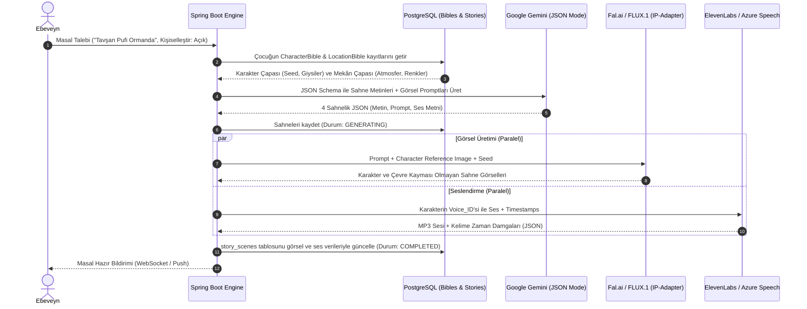

# 3-6 Yaş Yapay Zekâ Masal Platformu - Kapsamlı Mimari, Tutarlılık Motoru ve Kurumsal Veritabanı Şeması

Bu doküman; 3-6 yaş çocuklar için ebeveyn denetimli, tek seferlik ve etkileşimli (dallanan) masal üretebilen, **Karakter ve Çevre Tutarlılık Kütüphanelerine (Character & Location Bibles)** sahip, kurumsal seviyede **RBAC (Rol ve Yetki)** altyapısı barındıran, zengin kullanıcı/çocuk ve admin tablolarını içeren uçtan uca sistem tasarımını ve PostgreSQL şemasını tanımlar.

---

## 1. Görsel ve Anlatı Tutarlılık Algoritması (Character & Location Bibles)

Çocuk kitaplarında en büyük yapay zekâ problemi **karakter ve çevre kaymasıdır** (Örn: Tavşanın kıyafetinin 2. sayfada kırmızıdan maviye dönmesi veya ormandaki mantar evin şeklinin değişmesi). Bu sorunu çözmek için sistemimiz iki aşamalı bir **Bible (Kutsal Rehber)** katmanı kullanır:

### A. Karakter İncili (Character Bible)
1. **Görsel Çapa (Visual Anchor):** Karakter oluşturulduğunda anatomisi (tür, yaş/boyut, kürk/saç rengi, göz rengi), kalıcı giysileri ve ayırt edici aksesuarları (örn. *"sol kulağında sarı papatya olan bebek mavi fil"*) metinsel olarak dondurulur.
2. **Sabit Seed ve Referans Görseller (Model Sheet):** İlk oluşturulan karakter görselinin `seed` değeri ve önden/yandan duruş çizimleri (`reference_image_urls`) veritabanında saklanır.
3. **Difüzyon Entegrasyonu:** Fal.ai (FLUX.1 + IP-Adapter / PuLID) veya Midjourney `--cref` API'sine bu referans URL'ler gönderilerek her sahnede %100 aynı karakter çizdirilir.
4. **Ses Profili:** ElevenLabs veya Azure üzerinde seçilen `voice_id` karaktere atanır, masal boyunca aynı ses konuşur.

### B. Mekân / Çevre İncili (Location Bible)
1. **Atmosfer ve Işık Paleti:** Sahnenin geçtiği mekân (örn. *"Güneşli Papatya Vadisi"*) için sabit renk paleti, mimari tarz (ahşap masal evleri, mor mantarlar) ve hava durumu kilitlenir.
2. **Kalıcı İşaret Noktaları (Landmarks):** Arka planda her zaman görünecek nesneler (örn. *"Arka plandaki gökkuşağı şelalesi"*) her sahne prompt'una otomatik eklenir.

---

## 2. Sistem Mimarisi ve Teknoloji Yığını

* **Backend:** Spring Boot 3 (Java 21)
  * Spring Security + JWT + Granular Permissions (Yetki Tabanlı RBAC).
  * Spring Data JPA (PostgreSQL + Hibernate).
  * Asenkron İş Kuyruğu (Story & Scene Generation Job Orchestrator).
  * Resilience4j (AI API Circuit Breaker & Fallback: Gemini -> Groq).
* **Admin & Ebeveyn Web Paneli:** React (Vite) + Tailwind CSS + TanStack Query.
* **Mobil Uygulama:** React Native (Expo) + Reanimated (Sayfa çevirme) + Expo Speech / Native Audio (Karaoke kelime parlatma).
* **Depolama (Object Storage):** Cloudflare R2 / AWS S3 (WebP görseller, MP3 ses dosyaları, JSON kelime zaman damgaları).

---

## 3. Kurumsal İlişkisel Veritabanı Şeması (PostgreSQL DDL)

Aşağıdaki şema kurumsal SaaS gereksinimlerine uygun olarak 8 ana modülde tasarlanmıştır:

```sql
-- GEREKLİ EKLENTİLER
CREATE EXTENSION IF NOT EXISTS "uuid-ossp";

-- ============================================================================
-- MODÜL 1: KİMLİK DOĞRULAMA VE KURUMSAL RBAC (Rol ve Yetki Yönetimi)
-- ============================================================================

-- 1. KULLANICILAR (Ebeveynler ve Admin Personeli)
CREATE TABLE users (
    id BIGSERIAL PRIMARY KEY,
    username VARCHAR(100) UNIQUE NOT NULL,
    email VARCHAR(255) UNIQUE NOT NULL,
    password_hash VARCHAR(255) NOT NULL,
    phone_number VARCHAR(30),
    is_enabled BOOLEAN NOT NULL DEFAULT TRUE,
    is_email_verified BOOLEAN NOT NULL DEFAULT FALSE,
    is_account_non_locked BOOLEAN NOT NULL DEFAULT TRUE,
    failed_login_attempts INT NOT NULL DEFAULT 0,
    last_login_at TIMESTAMP WITH TIME ZONE,
    created_at TIMESTAMP WITH TIME ZONE DEFAULT CURRENT_TIMESTAMP,
    updated_at TIMESTAMP WITH TIME ZONE DEFAULT CURRENT_TIMESTAMP
);

-- 2. ROLLER (SUPER_ADMIN, ADMIN, MODERATOR, SUPPORT, PARENT)
CREATE TABLE roles (
    id BIGSERIAL PRIMARY KEY,
    name VARCHAR(50) UNIQUE NOT NULL, -- Örn: ROLE_SUPER_ADMIN, ROLE_PARENT
    display_name VARCHAR(100) NOT NULL,
    description VARCHAR(255),
    is_system_role BOOLEAN NOT NULL DEFAULT FALSE,
    created_at TIMESTAMP WITH TIME ZONE DEFAULT CURRENT_TIMESTAMP
);

-- 3. AYRINTILI YETKİLER (Permissions)
CREATE TABLE permissions (
    id BIGSERIAL PRIMARY KEY,
    name VARCHAR(100) UNIQUE NOT NULL, -- Örn: STORY_CREATE, USER_MANAGE, CREDIT_ADJUST, SYSTEM_CONFIG_EDIT
    module VARCHAR(50) NOT NULL,       -- STORY, USER, BILLING, MODERATION, SYSTEM
    description VARCHAR(255),
    created_at TIMESTAMP WITH TIME ZONE DEFAULT CURRENT_TIMESTAMP
);

-- 4. KULLANICI - ROL İLİŞKİSİ (Çoka-Çok)
CREATE TABLE user_roles (
    user_id BIGINT NOT NULL REFERENCES users(id) ON DELETE CASCADE,
    role_id BIGINT NOT NULL REFERENCES roles(id) ON DELETE CASCADE,
    assigned_at TIMESTAMP WITH TIME ZONE DEFAULT CURRENT_TIMESTAMP,
    assigned_by BIGINT REFERENCES users(id),
    PRIMARY KEY (user_id, role_id)
);

-- 5. ROL - YETKİ İLİŞKİSİ (Çoka-Çok)
CREATE TABLE role_permissions (
    role_id BIGINT NOT NULL REFERENCES roles(id) ON DELETE CASCADE,
    permission_id BIGINT NOT NULL REFERENCES permissions(id) ON DELETE CASCADE,
    PRIMARY KEY (role_id, permission_id)
);

-- 6. KULLANICI PROFİLLERİ (Ebeveyn Detay Bilgileri)
CREATE TABLE user_profiles (
    user_id BIGINT PRIMARY KEY REFERENCES users(id) ON DELETE CASCADE,
    first_name VARCHAR(100) NOT NULL,
    last_name VARCHAR(100) NOT NULL,
    preferred_language VARCHAR(10) DEFAULT 'tr',
    country VARCHAR(10) DEFAULT 'TR',
    avatar_url VARCHAR(500),
    notification_email BOOLEAN DEFAULT TRUE,
    notification_sms BOOLEAN DEFAULT FALSE,
    notification_push BOOLEAN DEFAULT TRUE,
    updated_at TIMESTAMP WITH TIME ZONE DEFAULT CURRENT_TIMESTAMP
);

-- 7. KULLANICI OTURUM VE CİHAZ YÖNETİMİ (Refresh Token & Session)
CREATE TABLE user_sessions (
    id BIGSERIAL PRIMARY KEY,
    user_id BIGINT NOT NULL REFERENCES users(id) ON DELETE CASCADE,
    refresh_token_hash VARCHAR(255) NOT NULL,
    device_name VARCHAR(150),
    device_type VARCHAR(50), -- MOBILE_IOS, MOBILE_ANDROID, WEB
    ip_address VARCHAR(45),
    user_agent TEXT,
    is_revoked BOOLEAN NOT NULL DEFAULT FALSE,
    expires_at TIMESTAMP WITH TIME ZONE NOT NULL,
    created_at TIMESTAMP WITH TIME ZONE DEFAULT CURRENT_TIMESTAMP
);

-- ============================================================================
-- MODÜL 2: ÇOCUK PROFİLLERİ, İLGİ ALANLARI VE VERİ İZOLASYONU
-- ============================================================================

-- 8. ÇOCUK PROFİLLERİ (Her Çocuğun Özel Masal Alanı)
CREATE TABLE child_profiles (
    id BIGSERIAL PRIMARY KEY,
    parent_id BIGINT NOT NULL REFERENCES users(id) ON DELETE CASCADE,
    name VARCHAR(100) NOT NULL,
    birth_date DATE,
    age INT NOT NULL CHECK (age >= 2 AND age <= 8),
    gender VARCHAR(20),
    favorite_animals TEXT,          -- "Yavru panda, renkli kelebek"
    favorite_colors TEXT,           -- "Pastel sarı, bebek mavisi"
    favorite_places TEXT,           -- "Ağaç ev, bulutlar ülkesi"
    special_interests TEXT,         -- "Dinozorlar, uzay gemileri, resim yapma"
    bedtime_hour TIME DEFAULT '20:30:00',
    avatar_url VARCHAR(500),
    is_active BOOLEAN NOT NULL DEFAULT TRUE,
    created_at TIMESTAMP WITH TIME ZONE DEFAULT CURRENT_TIMESTAMP,
    updated_at TIMESTAMP WITH TIME ZONE DEFAULT CURRENT_TIMESTAMP
);

-- 9. ÇOCUK MASAL OKUMA / DİNLEME GEÇMİŞİ
CREATE TABLE child_reading_sessions (
    id BIGSERIAL PRIMARY KEY,
    child_id BIGINT NOT NULL REFERENCES child_profiles(id) ON DELETE CASCADE,
    story_id BIGINT NOT NULL, -- FK aşağıda eklenecek
    last_completed_scene_index INT NOT NULL DEFAULT 1,
    duration_seconds INT NOT NULL DEFAULT 0,
    is_completed BOOLEAN NOT NULL DEFAULT FALSE,
    completed_at TIMESTAMP WITH TIME ZONE,
    session_date TIMESTAMP WITH TIME ZONE DEFAULT CURRENT_TIMESTAMP
);

-- 10. ÇOCUK ROZETLERİ VE MOTİVASYON (Gamification)
CREATE TABLE child_badges (
    id BIGSERIAL PRIMARY KEY,
    code VARCHAR(50) UNIQUE NOT NULL, -- FIRST_STORY_LISTENED, IMAGINATION_EXPLORER
    name VARCHAR(100) NOT NULL,
    description VARCHAR(255),
    icon_url VARCHAR(500) NOT NULL,
    target_count INT NOT NULL DEFAULT 1
);

CREATE TABLE child_achievements (
    id BIGSERIAL PRIMARY KEY,
    child_id BIGINT NOT NULL REFERENCES child_profiles(id) ON DELETE CASCADE,
    badge_id BIGINT NOT NULL REFERENCES child_badges(id) ON DELETE CASCADE,
    unlocked_at TIMESTAMP WITH TIME ZONE DEFAULT CURRENT_TIMESTAMP,
    UNIQUE(child_id, badge_id)
);

-- ============================================================================
-- MODÜL 3: TUTARLILIK İNCİLLERİ (Character Bible & Location Bible)
-- ============================================================================

-- 11. KARAKTER İNCİLİ (Character Bible - Karakter Kaymasını Engelleyen Tablo)
CREATE TABLE character_bibles (
    id BIGSERIAL PRIMARY KEY,
    child_id BIGINT REFERENCES child_profiles(id) ON DELETE CASCADE, -- NULL ise sistem genelindeki şablon karakterdir
    name VARCHAR(100) NOT NULL,
    species VARCHAR(50) NOT NULL,              -- Örn: "Bebek Fil", "Küçük Kız Çocuğu"
    personality_traits TEXT,                  -- "Çok neşeli, meraklı, dost canlısı"
    visual_anchor_tokens TEXT NOT NULL,       -- "cute tiny pastel blue baby elephant, yellow daisy crown on head"
    clothing_description TEXT,                -- "yeşil minik sırt çantası, sarı papatya tacı"
    eye_color VARCHAR(50),
    distinctive_features TEXT,                -- "Kocaman pembe yanaklar, minik kanatlar"
    voice_provider VARCHAR(50) DEFAULT 'ELEVENLABS',
    voice_id VARCHAR(100),                    -- TTS Voice ID eşleştirmesi
    base_seed BIGINT,                         -- Görsel üretimde sabit tutulacak referans seed
    reference_model_sheet_urls TEXT[],        -- Önden, yandan ve arkadan karakter çizim URL dizisi
    is_system_preset BOOLEAN NOT NULL DEFAULT FALSE,
    created_at TIMESTAMP WITH TIME ZONE DEFAULT CURRENT_TIMESTAMP
);

-- 12. MEKÂN / ÇEVRE İNCİLİ (Location Bible - Arka Plan Tutarlılık Tablosu)
CREATE TABLE location_bibles (
    id BIGSERIAL PRIMARY KEY,
    name VARCHAR(150) NOT NULL,               -- Örn: "Papatya Masal Ormanı"
    environment_type VARCHAR(100) NOT NULL,   -- Orman, Bulut Şatosu, Denizaltı Köyü
    atmosphere_description TEXT NOT NULL,     -- "Güneşli, ılık, tatlı pastel sarı-yeşil tonları"
    lighting_style VARCHAR(100) NOT NULL,     -- "Soft morning sun, gentle fairy sparkles, no darkness"
    architectural_style VARCHAR(100),         -- "Mantar evler, tahta köprüler"
    recurring_landmarks TEXT,                 -- "Arka planda daima görünen dev dönme dolap ve mor nehir"
    visual_anchor_tokens TEXT NOT NULL,       -- "whimsical fantasy woodland with glowing oversized mushrooms and wooden cottage"
    reference_image_urls TEXT[],              -- Mekânın referans görsel URL'leri
    base_seed BIGINT,
    is_system_preset BOOLEAN NOT NULL DEFAULT FALSE,
    created_at TIMESTAMP WITH TIME ZONE DEFAULT CURRENT_TIMESTAMP
);

-- ============================================================================
-- MODÜL 4: MASAL VE ETKİLEŞİMLİ DALLANMA MOTORU
-- ============================================================================

-- 13. MASALLAR ANA TABLOSU
CREATE TABLE stories (
    id BIGSERIAL PRIMARY KEY,
    child_id BIGINT NOT NULL REFERENCES child_profiles(id) ON DELETE CASCADE,
    parent_id BIGINT NOT NULL REFERENCES users(id) ON DELETE CASCADE,
    primary_character_id BIGINT REFERENCES character_bibles(id),
    primary_location_id BIGINT REFERENCES location_bibles(id),
    title VARCHAR(255) NOT NULL,
    theme VARCHAR(150) NOT NULL,             -- "Paylaşmak", "Doğa Sevgisi", "Cesaret"
    story_mode VARCHAR(50) NOT NULL DEFAULT 'SINGLE_SHOT', -- SINGLE_SHOT, INTERACTIVE
    personalized_used BOOLEAN NOT NULL DEFAULT FALSE,
    total_scenes INT NOT NULL DEFAULT 4,
    status VARCHAR(50) NOT NULL DEFAULT 'PENDING', -- PENDING, GENERATING, COMPLETED, FAILED
    error_message TEXT,
    cover_image_url VARCHAR(500),
    storage_expiry_date TIMESTAMP WITH TIME ZONE,  -- Ücretsiz plandaki saklama limiti için
    is_favorite BOOLEAN NOT NULL DEFAULT FALSE,
    created_at TIMESTAMP WITH TIME ZONE DEFAULT CURRENT_TIMESTAMP
);

-- 14. MASAL KARAKTERLERİ İLİŞKİSİ (Masalda Yer Alan Yan Karakterler)
CREATE TABLE story_characters (
    story_id BIGINT NOT NULL REFERENCES stories(id) ON DELETE CASCADE,
    character_id BIGINT NOT NULL REFERENCES character_bibles(id) ON DELETE CASCADE,
    role_in_story VARCHAR(50) DEFAULT 'COMPANION', -- PROTAGONIST, COMPANION, MENTOR
    PRIMARY KEY (story_id, character_id)
);

-- 15. MASAL SAHNELERİ (Her Sahnenin Görsel, Ses ve Karaoke Verisi)
CREATE TABLE story_scenes (
    id BIGSERIAL PRIMARY KEY,
    story_id BIGINT NOT NULL REFERENCES stories(id) ON DELETE CASCADE,
    location_id BIGINT REFERENCES location_bibles(id),
    scene_number INT NOT NULL,
    scene_text TEXT NOT NULL,
    voice_text TEXT NOT NULL,
    image_prompt TEXT NOT NULL,
    negative_prompt TEXT DEFAULT 'no text, no watermark, no horror, no dark colors, no deformed faces',
    image_url VARCHAR(500),
    audio_url VARCHAR(500),
    audio_duration_seconds DECIMAL(6, 2),
    timestamps_json JSONB,                   -- Salise düzeyinde kelime başlangıç/bitiş karaoke verisi
    generation_seed BIGINT,
    created_at TIMESTAMP WITH TIME ZONE DEFAULT CURRENT_TIMESTAMP,
    UNIQUE (story_id, scene_number)
);

-- 16. ETKİLEŞİMLİ MASAL DÜĞÜMLERİ (Karar Ağacı - Decision Tree)
CREATE TABLE interactive_nodes (
    id BIGSERIAL PRIMARY KEY,
    story_id BIGINT NOT NULL REFERENCES stories(id) ON DELETE CASCADE,
    scene_id BIGINT REFERENCES story_scenes(id) ON DELETE SET NULL,
    node_step INT NOT NULL,                  -- Kaçıncı karar noktası (1, 2)
    prompt_question VARCHAR(255) NOT NULL,  -- "Mavi kapıyı mı açalım, sarı patikadan mı gidelim?"
    question_audio_url VARCHAR(500),
    choice_a_text VARCHAR(100) NOT NULL,
    choice_a_icon VARCHAR(100) NOT NULL,
    choice_a_image_url VARCHAR(500),
    choice_b_text VARCHAR(100) NOT NULL,
    choice_b_icon VARCHAR(100) NOT NULL,
    choice_b_image_url VARCHAR(500),
    selected_choice VARCHAR(10),             -- 'A', 'B' veya NULL
    created_at TIMESTAMP WITH TIME ZONE DEFAULT CURRENT_TIMESTAMP
);

-- ============================================================================
-- MODÜL 5: ABONELİK, ÖDEME VE KREDİ SİSTEMİ
-- ============================================================================

-- 17. ABONELİK PLANLARI
CREATE TABLE subscription_plans (
    id BIGSERIAL PRIMARY KEY,
    plan_code VARCHAR(50) UNIQUE NOT NULL, -- FREE, STANDARD_MONTHLY, STANDARD_YEARLY, FAMILY_VIP
    name VARCHAR(100) NOT NULL,
    price DECIMAL(10, 2) NOT NULL DEFAULT 0.00,
    currency VARCHAR(10) NOT NULL DEFAULT 'TRY',
    billing_period VARCHAR(20) NOT NULL,   -- ONCE, MONTHLY, YEARLY
    monthly_story_credits INT NOT NULL,
    interactive_credits INT NOT NULL,
    max_child_profiles INT NOT NULL DEFAULT 1,
    storage_retention_days INT NOT NULL,   -- 7 (Free), 180 (Standart), 3650 (VIP)
    tts_quality VARCHAR(50) DEFAULT 'STANDARD', -- DEVICE_NATIVE, NEURAL_AI
    is_active BOOLEAN NOT NULL DEFAULT TRUE
);

-- 18. KULLANICI ABONELİKLERİ
CREATE TABLE user_subscriptions (
    id BIGSERIAL PRIMARY KEY,
    user_id BIGINT NOT NULL REFERENCES users(id) ON DELETE CASCADE,
    plan_id BIGINT NOT NULL REFERENCES subscription_plans(id),
    status VARCHAR(50) NOT NULL DEFAULT 'ACTIVE', -- ACTIVE, PAST_DUE, CANCELLED, EXPIRED
    start_date TIMESTAMP WITH TIME ZONE DEFAULT CURRENT_TIMESTAMP,
    end_date TIMESTAMP WITH TIME ZONE NOT NULL,
    auto_renew BOOLEAN NOT NULL DEFAULT TRUE,
    created_at TIMESTAMP WITH TIME ZONE DEFAULT CURRENT_TIMESTAMP
);

-- 19. KREDİ CÜZDANI
CREATE TABLE credit_wallets (
    id BIGSERIAL PRIMARY KEY,
    user_id BIGINT UNIQUE NOT NULL REFERENCES users(id) ON DELETE CASCADE,
    story_credit_balance INT NOT NULL DEFAULT 3,
    interactive_credit_balance INT NOT NULL DEFAULT 1,
    updated_at TIMESTAMP WITH TIME ZONE DEFAULT CURRENT_TIMESTAMP
);

-- 20. KREDİ İŞLEM HAREKETLERİ
CREATE TABLE credit_transactions (
    id BIGSERIAL PRIMARY KEY,
    wallet_id BIGINT NOT NULL REFERENCES credit_wallets(id) ON DELETE CASCADE,
    transaction_type VARCHAR(50) NOT NULL, -- PLAN_RECHARGE, PURCHASE, STORY_SPENT, REFUND, ADMIN_GIFT
    story_credit_amount INT NOT NULL,
    interactive_credit_amount INT NOT NULL,
    description VARCHAR(255),
    performed_by BIGINT REFERENCES users(id), -- Admin tarafından yüklendiyse admin_id
    created_at TIMESTAMP WITH TIME ZONE DEFAULT CURRENT_TIMESTAMP
);

-- 21. FATURALAR VE ÖDEME İŞLEMLERİ
CREATE TABLE invoices (
    id BIGSERIAL PRIMARY KEY,
    user_id BIGINT NOT NULL REFERENCES users(id),
    subscription_id BIGINT REFERENCES user_subscriptions(id),
    payment_provider VARCHAR(50) NOT NULL, -- IYZICO, STRIPE, APPLE_IAP, GOOGLE_PLAY
    provider_transaction_id VARCHAR(255) UNIQUE,
    amount DECIMAL(10, 2) NOT NULL,
    currency VARCHAR(10) NOT NULL DEFAULT 'TRY',
    payment_status VARCHAR(50) NOT NULL,   -- SUCCESS, PENDING, FAILED, REFUNDED
    invoice_pdf_url VARCHAR(500),
    paid_at TIMESTAMP WITH TIME ZONE,
    created_at TIMESTAMP WITH TIME ZONE DEFAULT CURRENT_TIMESTAMP
);

-- ============================================================================
-- MODÜL 6: KAPSAMLI ADMİN PANELİ VE SİSTEM YÖNETİMİ TABLOLARI
-- ============================================================================

-- 22. SİSTEM PARAMETRELERİ VE GENEL AYARLAR
CREATE TABLE system_settings (
    id BIGSERIAL PRIMARY KEY,
    setting_key VARCHAR(100) UNIQUE NOT NULL, -- Örn: DEFAULT_AI_MODEL, FREE_TIER_MONTHLY_CREDIT
    setting_value TEXT NOT NULL,
    data_type VARCHAR(30) NOT NULL,          -- STRING, INTEGER, BOOLEAN, JSON
    category VARCHAR(50) NOT NULL,           -- AI_CONFIG, BILLING, SAFETY, STORAGE
    description VARCHAR(255),
    is_public BOOLEAN NOT NULL DEFAULT FALSE, -- Mobil/Web uygulamasının okuyabileceği ayar mı?
    updated_by BIGINT REFERENCES users(id),
    updated_at TIMESTAMP WITH TIME ZONE DEFAULT CURRENT_TIMESTAMP
);

-- 23. DIŞ YAPAY ZEKÂ SAĞLAYICI VE API KONFİGÜRASYONLARI
CREATE TABLE ai_providers_config (
    id BIGSERIAL PRIMARY KEY,
    provider_type VARCHAR(50) NOT NULL,      -- LLM, IMAGE, TTS, MODERATION
    provider_name VARCHAR(100) NOT NULL,     -- GEMINI, GROQ, CLOUDFLARE_AI, ELEVENLABS
    active_model_name VARCHAR(150) NOT NULL, -- "gemini-2.5-flash", "@cf/black-forest-labs/flux-1-schnell"
    api_endpoint_url VARCHAR(500),
    is_active BOOLEAN NOT NULL DEFAULT TRUE,
    priority INT NOT NULL DEFAULT 1,         -- Yedeklilik önceliği (1: Birincil, 2: Yedek)
    timeout_ms INT NOT NULL DEFAULT 15000,
    rate_limit_rpm INT DEFAULT 60,
    cost_per_1k_tokens DECIMAL(8, 6) DEFAULT 0.000000,
    updated_at TIMESTAMP WITH TIME ZONE DEFAULT CURRENT_TIMESTAMP
);

-- 24. HİKAYE VE PROMPT ŞABLONLARI YÖNETİMİ
CREATE TABLE prompt_templates (
    id BIGSERIAL PRIMARY KEY,
    template_key VARCHAR(100) UNIQUE NOT NULL, -- "STORY_GENERATION_3_6", "INTERACTIVE_BRANCH_PROMPT"
    version INT NOT NULL DEFAULT 1,
    system_prompt TEXT NOT NULL,
    user_prompt_template TEXT NOT NULL,
    target_age_group VARCHAR(20) DEFAULT '3-6',
    is_active BOOLEAN NOT NULL DEFAULT TRUE,
    created_by BIGINT REFERENCES users(id),
    updated_at TIMESTAMP WITH TIME ZONE DEFAULT CURRENT_TIMESTAMP
);

-- 25. YASAKLI KELİMELER VE İÇERİK KARA LİSTESİ (Blacklist)
CREATE TABLE content_blacklists (
    id BIGSERIAL PRIMARY KEY,
    keyword VARCHAR(100) UNIQUE NOT NULL,
    category VARCHAR(50) NOT NULL,           -- FEAR, VIOLENCE, GORE, SEPARATION_ANXIETY, INAPPROPRIATE
    severity VARCHAR(20) NOT NULL,           -- BLOCK, WARN_AND_FLAG
    action_type VARCHAR(50) NOT NULL,        -- AUTO_REJECT, SANITIZE_REPLACE
    replacement_word VARCHAR(100),
    is_active BOOLEAN NOT NULL DEFAULT TRUE,
    created_at TIMESTAMP WITH TIME ZONE DEFAULT CURRENT_TIMESTAMP
);

-- 26. ADMİN İŞLEM VE GÜVENLİK AUDIT LOGLARI (Tüm Yetkili Hareketleri)
CREATE TABLE admin_audit_logs (
    id BIGSERIAL PRIMARY KEY,
    admin_user_id BIGINT NOT NULL REFERENCES users(id),
    action VARCHAR(100) NOT NULL,            -- USER_ROLE_CHANGED, CREDIT_ADDED, SETTING_UPDATED
    target_entity VARCHAR(100) NOT NULL,     -- users, subscriptions, system_settings
    target_id BIGINT,
    old_value_json JSONB,
    new_value_json JSONB,
    ip_address VARCHAR(45),
    user_agent TEXT,
    created_at TIMESTAMP WITH TIME ZONE DEFAULT CURRENT_TIMESTAMP
);

-- 27. SİSTEM DUYURULARI VE BİLDİRİMLER (Admin Tarafından Yayınlanan)
CREATE TABLE broadcast_announcements (
    id BIGSERIAL PRIMARY KEY,
    title VARCHAR(200) NOT NULL,
    message TEXT NOT NULL,
    target_role VARCHAR(50) DEFAULT 'ALL',   -- ALL, ROLE_PARENT, ROLE_ADMIN
    start_date TIMESTAMP WITH TIME ZONE NOT NULL,
    end_date TIMESTAMP WITH TIME ZONE NOT NULL,
    is_active BOOLEAN NOT NULL DEFAULT TRUE,
    created_by BIGINT REFERENCES users(id),
    created_at TIMESTAMP WITH TIME ZONE DEFAULT CURRENT_TIMESTAMP
);

-- ============================================================================
-- MODÜL 7: GÜVENLİK, EBEVEYN KİLİDİ VE MODERASYON
-- ============================================================================

-- 28. İÇERİK MODERASYON VE ŞÜPHELİ İÇERİK KUYRUĞU
CREATE TABLE moderation_tickets (
    id BIGSERIAL PRIMARY KEY,
    story_id BIGINT REFERENCES stories(id),
    user_id BIGINT REFERENCES users(id),
    prompt_text TEXT NOT NULL,
    flagged_keywords TEXT,
    risk_score DECIMAL(4, 2),                -- 0.00 ile 1.00 arası
    status VARCHAR(50) NOT NULL DEFAULT 'PENDING', -- PENDING, APPROVED, REJECTED
    moderator_notes TEXT,
    reviewed_by BIGINT REFERENCES users(id),
    reviewed_at TIMESTAMP WITH TIME ZONE,
    created_at TIMESTAMP WITH TIME ZONE DEFAULT CURRENT_TIMESTAMP
);

-- 29. EBEVEYN KİLİDİ (PARENTAL GATE) DENEME KAYITLARI
CREATE TABLE parental_gate_attempts (
    id BIGSERIAL PRIMARY KEY,
    user_id BIGINT NOT NULL REFERENCES users(id) ON DELETE CASCADE,
    challenge_question VARCHAR(100) NOT NULL, -- Örn: "DÖRT yazan butona dokunun" veya "5 + 2 = ?"
    is_success BOOLEAN NOT NULL,
    action_type VARCHAR(100) NOT NULL,       -- CREATE_STORY, OPEN_SETTINGS, BUY_CREDIT
    ip_address VARCHAR(45),
    created_at TIMESTAMP WITH TIME ZONE DEFAULT CURRENT_TIMESTAMP
);

-- ============================================================================
-- MODÜL 8: GERİ BİLDİRİM VE BEĞENİ
-- ============================================================================

-- 30. MASAL BEĞENİ VE EBEVEYN DEĞERLENDİRMELERİ
CREATE TABLE story_feedbacks (
    id BIGSERIAL PRIMARY KEY,
    story_id BIGINT NOT NULL REFERENCES stories(id) ON DELETE CASCADE,
    parent_id BIGINT NOT NULL REFERENCES users(id) ON DELETE CASCADE,
    rating INT CHECK (rating >= 1 AND rating <= 5),
    comment TEXT,
    child_enjoyed BOOLEAN NOT NULL DEFAULT TRUE,
    created_at TIMESTAMP WITH TIME ZONE DEFAULT CURRENT_TIMESTAMP
);

-- PERFORMANS İNDEKSLERİ
CREATE INDEX idx_users_email ON users(email);
CREATE INDEX idx_child_profiles_parent_id ON child_profiles(parent_id);
CREATE INDEX idx_stories_child_id ON stories(child_id);
CREATE INDEX idx_stories_parent_id ON stories(parent_id);
CREATE INDEX idx_story_scenes_story_id ON story_scenes(story_id);
CREATE INDEX idx_character_bibles_child_id ON character_bibles(child_id);
CREATE INDEX idx_admin_audit_logs_admin_id ON admin_audit_logs(admin_user_id);
CREATE INDEX idx_moderation_tickets_status ON moderation_tickets(status);
```

---

## 4. Tutarlılık (Bible) ve Masal Üretim Veri Akışı



---

## 5. Güvenlik, İzolasyon ve Temizleme Politikaları

1. **Çoklu Çocuk İzolasyonu (Row-Level Security):**
   * Her sorgu `WHERE story.child_id = :activeChildId AND story.parent_id = :authenticatedParentId` mantığıyla çalışır. Ebeveyn çocuk profili değiştirdiğinde arayüz state'i anında güncellenir.
2. **Karakter ve Çevre Kütüphanesi Yeniden Kullanımı:**
   * Çocuk bir seriyi sevdiyse (örn. *"Minik Dino Can"*), sonraki tüm masallarda aynı `character_bibles` kaydı seçilerek aynı karakterin yeni maceraları üretilir.
3. **Otomatik Depolama Temizliği (Cron Job):**
   * Spring Boot `@Scheduled(cron = "0 0 3 * * ?")` (Her gece 03:00) görevi, `storage_expiry_date < NOW()` olan ücretsiz masalların R2/S3 üzerindeki MP3 ve WebP dosyalarını siler ve veritabanı durumunu `ARCHIVED` olarak işaretler.
