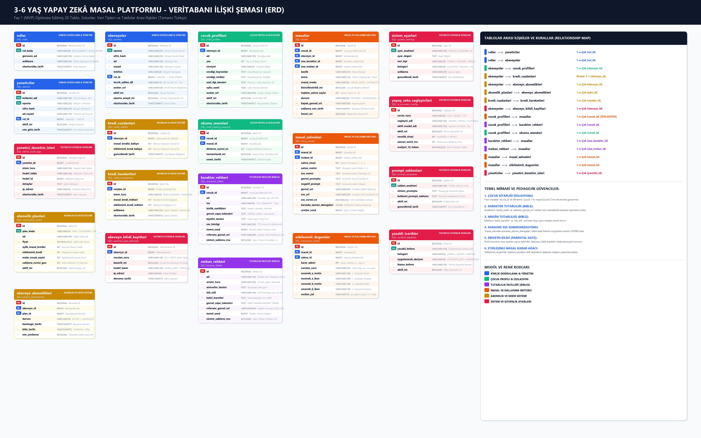

# 3-6 Yaş Yapay Zekâ Masal Platformu - Mimari, Veritabanı ve İlişki Şeması (Faz 1 MVP)

Bu doküman; 3-6 yaş çocuklar için ebeveyn denetimli, tek seferlik ve etkileşimli masal platformunun **1. Etabı (MVP)** için optimize edilmiş 20 tabloluk veritabanı şemasını, sütun detaylarını, ilişkilerini ve PostgreSQL DDL kodlarını içerir.


> 💡 *Şemayı tarayıcıda dinamik olarak yakınlaştırmak ve incelemek için [`veritabani_sema_semasi.html`](./veritabani_sema_semasi.html) dosyasını açabilirsiniz.*

---

## 1. Faz 1 Optimizasyon ve Sadeleştirme Kararları

1. **`users` ve `user_profiles` Ayrıştırıldı:**
   * İdari personel için **`admins`**, masal üreten ve çocuklarını yöneten ebeveynler için **`parents`** tablosu oluşturuldu.
   * `user_profiles` kaldırıldı, tüm ebeveyn alanları doğrudan `parents` içine alındı (veri tabanı şişmesi ve gereksiz JOIN önlendi).
2. **Rol Yapısı Sadeleştirildi (`role_id`):**
   * Faz 1 için gereksiz olan `user_roles`, `permissions` ve `role_permissions` ara tabloları elendi.
   * Hem `admins` hem de `parents` tablolarına doğrudan **`role_id`** sütunu eklendi (`roles` tablosuna FK).
3. **İlk Etap İçin Elenen Tablolar:**
   * `child_badges` ve `child_achievements` (Oyunlaştırma Faz 2'ye ertelendi).
   * `broadcast_announcements` (Toplu duyurular Faz 2'ye ertelendi).
   * `invoices` (Fatura ve bakiye takibi `credit_transactions` üzerinden yürütülecektir).
   * `user_sessions` (Stateless JWT token mimarisine geçilerek DB oturum tablosu yükü kaldırıldı).
   * `story_characters` (İlk etapta masallar tek ana karaktere odaklanacağından `stories.primary_character_id` yeterli görüldü).
4. **Karakter ve Mekân Tutarlılığı (Bibles) Korundu:**
   * Görsel kaymasını önleyen `character_bibles` ve `location_bibles` korundu.
   * Çocukların birbirinin masalını görmesini engelleyen `child_profiles` veri izolasyonu korundu.

---

## 2. Tablolar ve Sütun Detayları (Türkçe Açıklamalı)

### 👤 Modül 1: Kimlik Doğrulama & Yönetim
* **`roller (roles)`:** Sistemdeki rol tanımları (`ROLE_PARENT`, `ROLE_ADMIN`, `ROLE_SUPER_ADMIN`).
  * `id` [PK], `rol_kodu (name)` [UQ], `gorunen_ad (display_name)`, `aciklama (description)`, `olusturuldu_tarih (created_at)`
* **`yoneticiler (admins)`:** İdari personel ve moderatör hesapları.
  * `id` [PK], `kullanici_adi (username)` [UQ], `eposta (email)` [UQ], `sifre_hash (password_hash)`, `ad_soyad (full_name)`, `rol_id` [FK -> roller], `aktif_mi (is_active)`, `son_giris_tarih (last_login_at)`
* **`ebeveynler (parents)`:** Masal üreten ve çocuklarını kaydeden ebeveynler.
  * `id` [PK], `eposta (email)` [UQ], `sifre_hash (password_hash)`, `ad (first_name)`, `soyad (last_name)`, `telefon (phone_number)`, `rol_id` [FK -> roller], `tercih_edilen_dil (preferred_language)`, `avatar_url`, `aktif_mi (is_active)`, `eposta_onayli_mi (is_email_verified)`

### 👶 Modül 2: Çocuk Profili & İzolasyon
* **`cocuk_profilleri (child_profiles)`:** Her çocuğun izole masal kitaplığı ve kişiselleştirme tercihleri.
  * `id` [PK], `ebeveyn_id (parent_id)` [FK -> ebeveynler], `ad (name)`, `yas (age: 2-8)`, `cinsiyet (gender)`, `sevdigi_hayvanlar`, `sevdigi_renkler`, `ozel_ilgi_alanlari`, `uyku_saati (bedtime_hour)`, `avatar_url`, `aktif_mi`
* **`okuma_seanslari (child_reading_sessions)`:** Çocuğun masalı dinleme süresi ve tamamlama geçmişi.
  * `id` [PK], `cocuk_id (child_id)` [FK -> cocuk_profilleri], `masal_id (story_id)` [FK -> masallar], `dinleme_suresi_sn (duration_seconds)`, `tamamlandi_mi (is_completed)`, `seans_tarihi`

### 🎨 Modül 3: Tutarlılık İncilleri (Bibles)
* **`karakter_rehberi (character_bibles)`:** Karakterin sahneler boyunca aynı kalmasını sağlayan sabitler.
  * `id` [PK], `cocuk_id (child_id)` [FK -> cocuk_profilleri, NULL ise genel sistem şablonu], `ad (name)`, `tur (species)`, `kisilik_ozellikleri`, `gorsel_capa_tokenleri (visual_anchor_tokens)`, `kiyafet_tanimi`, `ses_kimligi (voice_id)`, `temel_seed (base_seed)`, `referans_gorsel_url`, `sistem_sablonu_mu`
* **`mekan_rehberi (location_bibles)`:** Arka planın ve doğanın sahneler boyunca tutarlı kalması.
  * `id` [PK], `ad (name)`, `ortam_turu (environment_type)`, `atmosfer_tanimi`, `isik_stili (lighting_style)`, `kalici_isaretler (recurring_landmarks)`, `gorsel_capa_tokenleri`, `referans_gorsel_url`, `temel_seed`, `sistem_sablonu_mu`

### 📖 Modül 4: Masal ve Dallanma Motoru
* **`masallar (stories)`:** Masalların ana kaydı (kesinlikle tek bir `cocuk_id`'ye bağlıdır).
  * `id` [PK], `cocuk_id` [FK -> cocuk_profilleri], `ebeveyn_id` [FK -> ebeveynler], `ana_karakter_id` [FK -> karakter_rehberi], `ana_mekan_id` [FK -> mekan_rehberi], `baslik (title)`, `tema (theme)`, `masal_modu (SINGLE_SHOT / INTERACTIVE)`, `kisisellestirildi_mi`, `toplam_sahne_sayisi (4-6)`, `durum (PENDING / GENERATING / COMPLETED)`, `kapak_gorseli_url`, `saklama_son_tarih`, `favori_mi`
* **`masal_sahneleri (story_scenes)`:** 4-6 sahnelik metin, WebP görsel, MP3 ses ve kelime zaman damgaları.
  * `id` [PK], `masal_id` [FK -> masallar], `mekan_id` [FK -> mekan_rehberi], `sahne_sirasi`, `sahne_metni`, `ses_metni`, `gorsel_promptu`, `negatif_prompt`, `gorsel_url`, `ses_url`, `ses_suresi_sn`, `karaoke_zaman_damgalari (timestamps_json)`, `uretim_seed`
* **`etkilesimli_dugumler (interactive_nodes)`:** Çocuğun masal akışını yönettiği A/B karar noktaları.
  * `id` [PK], `masal_id` [FK -> masallar], `sahne_id` [FK -> masal_sahneleri], `karar_adimi`, `sorulan_soru`, `secenek_a_metin`, `secenek_a_ikon`, `secenek_b_metin`, `secenek_b_ikon`, `secilen_yol`

### 💳 Modül 5: Abonelik ve Kredi Sistemi
* **`abonelik_planlari (subscription_plans)`:** Ücretsiz, Standart ve Aile VIP paket tanımları.
  * `id` [PK], `plan_kodu` [UQ], `ad`, `fiyat`, `aylik_masal_kredisi`, `etkilesimli_kredi`, `maks_cocuk_sayisi`, `saklama_suresi_gun (7 / 180 / 3650)`, `aktif_mi`
* **`ebeveyn_abonelikleri (parent_subscriptions)`:** Ebeveynin aktif abonelik durumu.
  * `id` [PK], `ebeveyn_id` [FK -> ebeveynler], `plan_id` [FK -> abonelik_planlari], `durum`, `baslangic_tarihi`, `bitis_tarihi`, `oto_yenileme`
* **`kredi_cuzdanlari (credit_wallets)`:** Ebeveynin normal ve etkileşimli masal bakiyesi.
  * `id` [PK], `ebeveyn_id` [UQ, FK -> ebeveynler (Birebir 1-1)], `masal_kredisi_bakiye`, `etkilesimli_kredi_bakiye`, `guncellendi_tarih`
* **`kredi_hareketleri (credit_transactions)`:** Kredi harcama, yükleme ve iade kayıtları.
  * `id` [PK], `cuzdan_id` [FK -> kredi_cuzdanlari], `islem_turu`, `masal_kredi_miktari`, `etkilesimli_kredi_miktari`, `aciklama`, `olusturuldu_tarih`

### ⚙️ Modül 6: Sistem Parametreleri, Güvenlik ve Ebeveyn Kilidi
* **`sistem_ayarlari (system_settings)`:** Kod değiştirmeden yönetilen ayarlar.
  * `id` [PK], `ayar_anahtari` [UQ], `ayar_degeri`, `veri_tipi`, `kategori`, `aciklama`, `guncellendi_tarih`
* **`yapay_zeka_saglayicilari (ai_providers_config)`:** Dış AI servisleri (Gemini, Groq, Cloudflare AI, ElevenLabs) öncelik ve timeout ayarları.
  * `id` [PK], `servis_turu`, `saglayici_adi`, `aktif_model_adi`, `aktif_mi`, `oncelik_sirasi (1: Birincil, 2: Yedek)`, `zaman_asimi_ms`, `maliyet_1k_token`
* **`prompt_sablonlari (prompt_templates)`:** Masal üretim promptlarının versiyonlu yönetimi.
  * `id` [PK], `sablon_anahtari` [UQ], `sistem_promptu`, `kullanici_prompt_sablonu`, `aktif_mi`, `guncellendi_tarih`
* **`yasakli_icerikler (content_blacklists)`:** Pedagojik güvenlik kara listesi (korku, şiddet, ayrılık anksiyetesi kelimeleri).
  * `id` [PK], `yasakli_kelime` [UQ], `kategori`, `uygulanacak_aksiyon`, `ikame_kelime`, `aktif_mi`
* **`yonetici_denetim_izleri (admin_audit_logs)`:** Yöneticilerin yaptığı kritik işlemlerin güvenlik logları.
  * `id` [PK], `yonetici_id` [FK -> yoneticiler], `islem_turu`, `hedef_tablo`, `hedef_id`, `detaylar`, `ip_adresi`, `olusturuldu_tarih`
* **`ebeveyn_kilidi_kayitlari (parental_gate_attempts)`:** Çocukların yanlışlıkla kredi harcamasını veya ayarları açmasını önleyen kilit kayıtları.
  * `id` [PK], `ebeveyn_id` [FK -> ebeveynler], `sorulan_soru`, `basarili_mi`, `hedef_islem`, `ip_adresi`, `deneme_tarihi`

---

## 3. Tablolar Arası İlişki Haritası (Relationship Map)

* `roller` ──▶ `yoneticiler` (1-e-Çok, `rol_id`)
* `roller` ──▶ `ebeveynler` (1-e-Çok, `rol_id`)
* `ebeveynler` ──▶ `cocuk_profilleri` (1-e-Çok, `ebeveyn_id`)
* `ebeveynler` ──▶ `kredi_cuzdanlari` (Birebir 1-1, `ebeveyn_id`)
* `ebeveynler` ──▶ `ebeveyn_abonelikleri` (1-e-Çok, `ebeveyn_id`)
* `abonelik_planlari` ──▶ `ebeveyn_abonelikleri` (1-e-Çok, `plan_id`)
* `kredi_cuzdanlari` ──▶ `kredi_hareketleri` (1-e-Çok, `cuzdan_id`)
* `ebeveynler` ──▶ `ebeveyn_kilidi_kayitlari` (1-e-Çok, `ebeveyn_id`)
* `cocuk_profilleri` ──▶ `masallar` (1-e-Çok, `cocuk_id` - **Veri İzolasyonu**)
* `cocuk_profilleri` ──▶ `karakter_rehberi` (1-e-Çok, `cocuk_id`)
* `cocuk_profilleri` ──▶ `okuma_seanslari` (1-e-Çok, `cocuk_id`)
* `karakter_rehberi` ──▶ `masallar` (1-e-Çok, `ana_karakter_id` - **Karakter Tutarlılığı**)
* `mekan_rehberi` ──▶ `masallar` (1-e-Çok, `ana_mekan_id` - **Mekân Tutarlılığı**)
* `masallar` ──▶ `masal_sahneleri` (1-e-Çok, `masal_id`)
* `masallar` ──▶ `etkilesimli_dugumler` (1-e-Çok, `masal_id` - **Karar Ağacı**)
* `yoneticiler` ──▶ `yonetici_denetim_izleri` (1-e-Çok, `yonetici_id`)

---

## 4. PostgreSQL DDL Kaynak Kodu

```sql
CREATE EXTENSION IF NOT EXISTS "uuid-ossp";

-- 1. ROLLER
CREATE TABLE roles (
    id BIGSERIAL PRIMARY KEY,
    name VARCHAR(50) UNIQUE NOT NULL,
    display_name VARCHAR(100) NOT NULL,
    description VARCHAR(255),
    created_at TIMESTAMP WITH TIME ZONE DEFAULT CURRENT_TIMESTAMP
);

-- 2. YÖNETİCİLER
CREATE TABLE admins (
    id BIGSERIAL PRIMARY KEY,
    username VARCHAR(100) UNIQUE NOT NULL,
    email VARCHAR(255) UNIQUE NOT NULL,
    password_hash VARCHAR(255) NOT NULL,
    full_name VARCHAR(150) NOT NULL,
    role_id BIGINT NOT NULL REFERENCES roles(id),
    is_active BOOLEAN NOT NULL DEFAULT TRUE,
    last_login_at TIMESTAMP WITH TIME ZONE,
    created_at TIMESTAMP WITH TIME ZONE DEFAULT CURRENT_TIMESTAMP,
    updated_at TIMESTAMP WITH TIME ZONE DEFAULT CURRENT_TIMESTAMP
);

-- 3. EBEVEYNLER
CREATE TABLE parents (
    id BIGSERIAL PRIMARY KEY,
    email VARCHAR(255) UNIQUE NOT NULL,
    password_hash VARCHAR(255) NOT NULL,
    first_name VARCHAR(100) NOT NULL,
    last_name VARCHAR(100) NOT NULL,
    phone_number VARCHAR(30),
    role_id BIGINT NOT NULL REFERENCES roles(id),
    preferred_language VARCHAR(10) DEFAULT 'tr',
    avatar_url VARCHAR(500),
    is_active BOOLEAN NOT NULL DEFAULT TRUE,
    is_email_verified BOOLEAN NOT NULL DEFAULT FALSE,
    last_login_at TIMESTAMP WITH TIME ZONE,
    created_at TIMESTAMP WITH TIME ZONE DEFAULT CURRENT_TIMESTAMP,
    updated_at TIMESTAMP WITH TIME ZONE DEFAULT CURRENT_TIMESTAMP
);

-- 4. ÇOCUK PROFİLLERİ
CREATE TABLE child_profiles (
    id BIGSERIAL PRIMARY KEY,
    parent_id BIGINT NOT NULL REFERENCES parents(id) ON DELETE CASCADE,
    name VARCHAR(100) NOT NULL,
    age INT NOT NULL CHECK (age >= 2 AND age <= 8),
    gender VARCHAR(20),
    favorite_animals TEXT,
    favorite_colors TEXT,
    special_interests TEXT,
    bedtime_hour TIME DEFAULT '20:30:00',
    avatar_url VARCHAR(500),
    is_active BOOLEAN NOT NULL DEFAULT TRUE,
    created_at TIMESTAMP WITH TIME ZONE DEFAULT CURRENT_TIMESTAMP,
    updated_at TIMESTAMP WITH TIME ZONE DEFAULT CURRENT_TIMESTAMP
);

-- 5. ÇOCUK OKUMA SEANSLARI
CREATE TABLE child_reading_sessions (
    id BIGSERIAL PRIMARY KEY,
    child_id BIGINT NOT NULL REFERENCES child_profiles(id) ON DELETE CASCADE,
    story_id BIGINT NOT NULL,
    duration_seconds INT NOT NULL DEFAULT 0,
    is_completed BOOLEAN NOT NULL DEFAULT FALSE,
    session_date TIMESTAMP WITH TIME ZONE DEFAULT CURRENT_TIMESTAMP
);

-- 6. KARAKTER İNCİLİ (TUTARLILIK)
CREATE TABLE character_bibles (
    id BIGSERIAL PRIMARY KEY,
    child_id BIGINT REFERENCES child_profiles(id) ON DELETE CASCADE,
    name VARCHAR(100) NOT NULL,
    species VARCHAR(50) NOT NULL,
    personality_traits TEXT,
    visual_anchor_tokens TEXT NOT NULL,
    clothing_description TEXT,
    voice_id VARCHAR(100),
    base_seed BIGINT,
    reference_image_url VARCHAR(500),
    is_system_preset BOOLEAN NOT NULL DEFAULT FALSE,
    created_at TIMESTAMP WITH TIME ZONE DEFAULT CURRENT_TIMESTAMP
);

-- 7. MEKÂN İNCİLİ (TUTARLILIK)
CREATE TABLE location_bibles (
    id BIGSERIAL PRIMARY KEY,
    name VARCHAR(150) NOT NULL,
    environment_type VARCHAR(100) NOT NULL,
    atmosphere_description TEXT NOT NULL,
    lighting_style VARCHAR(100) NOT NULL,
    recurring_landmarks TEXT,
    visual_anchor_tokens TEXT NOT NULL,
    reference_image_url VARCHAR(500),
    base_seed BIGINT,
    is_system_preset BOOLEAN NOT NULL DEFAULT FALSE,
    created_at TIMESTAMP WITH TIME ZONE DEFAULT CURRENT_TIMESTAMP
);

-- 8. MASALLAR
CREATE TABLE stories (
    id BIGSERIAL PRIMARY KEY,
    child_id BIGINT NOT NULL REFERENCES child_profiles(id) ON DELETE CASCADE,
    parent_id BIGINT NOT NULL REFERENCES parents(id) ON DELETE CASCADE,
    primary_character_id BIGINT REFERENCES character_bibles(id),
    primary_location_id BIGINT REFERENCES location_bibles(id),
    title VARCHAR(255) NOT NULL,
    theme VARCHAR(150) NOT NULL,
    story_mode VARCHAR(50) NOT NULL DEFAULT 'SINGLE_SHOT',
    personalized_used BOOLEAN NOT NULL DEFAULT FALSE,
    total_scenes INT NOT NULL DEFAULT 4,
    status VARCHAR(50) NOT NULL DEFAULT 'PENDING',
    cover_image_url VARCHAR(500),
    storage_expiry_date TIMESTAMP WITH TIME ZONE,
    is_favorite BOOLEAN NOT NULL DEFAULT FALSE,
    created_at TIMESTAMP WITH TIME ZONE DEFAULT CURRENT_TIMESTAMP
);

-- 9. MASAL SAHNELERİ
CREATE TABLE story_scenes (
    id BIGSERIAL PRIMARY KEY,
    story_id BIGINT NOT NULL REFERENCES stories(id) ON DELETE CASCADE,
    location_id BIGINT REFERENCES location_bibles(id),
    scene_number INT NOT NULL,
    scene_text TEXT NOT NULL,
    voice_text TEXT NOT NULL,
    image_prompt TEXT NOT NULL,
    negative_prompt TEXT DEFAULT 'no text, no watermark, no dark colors, no horror',
    image_url VARCHAR(500),
    audio_url VARCHAR(500),
    audio_duration_seconds DECIMAL(6, 2),
    timestamps_json JSONB,
    generation_seed BIGINT,
    created_at TIMESTAMP WITH TIME ZONE DEFAULT CURRENT_TIMESTAMP,
    UNIQUE (story_id, scene_number)
);

-- 10. ETKİLEŞİMLİ DÜĞÜMLER
CREATE TABLE interactive_nodes (
    id BIGSERIAL PRIMARY KEY,
    story_id BIGINT NOT NULL REFERENCES stories(id) ON DELETE CASCADE,
    scene_id BIGINT REFERENCES story_scenes(id) ON DELETE SET NULL,
    node_step INT NOT NULL,
    prompt_question VARCHAR(255) NOT NULL,
    choice_a_text VARCHAR(100) NOT NULL,
    choice_a_icon VARCHAR(100) NOT NULL,
    choice_b_text VARCHAR(100) NOT NULL,
    choice_b_icon VARCHAR(100) NOT NULL,
    selected_choice VARCHAR(10),
    created_at TIMESTAMP WITH TIME ZONE DEFAULT CURRENT_TIMESTAMP
);

-- 11. ABONELİK PLANLARI
CREATE TABLE subscription_plans (
    id BIGSERIAL PRIMARY KEY,
    plan_code VARCHAR(50) UNIQUE NOT NULL,
    name VARCHAR(100) NOT NULL,
    price DECIMAL(10, 2) NOT NULL DEFAULT 0.00,
    monthly_story_credits INT NOT NULL,
    interactive_credits INT NOT NULL,
    max_child_profiles INT NOT NULL DEFAULT 1,
    storage_retention_days INT NOT NULL,
    is_active BOOLEAN NOT NULL DEFAULT TRUE
);

-- 12. EBEVEYN ABONELİKLERİ
CREATE TABLE parent_subscriptions (
    id BIGSERIAL PRIMARY KEY,
    parent_id BIGINT NOT NULL REFERENCES parents(id) ON DELETE CASCADE,
    plan_id BIGINT NOT NULL REFERENCES subscription_plans(id),
    status VARCHAR(50) NOT NULL DEFAULT 'ACTIVE',
    start_date TIMESTAMP WITH TIME ZONE DEFAULT CURRENT_TIMESTAMP,
    end_date TIMESTAMP WITH TIME ZONE NOT NULL,
    auto_renew BOOLEAN NOT NULL DEFAULT TRUE,
    created_at TIMESTAMP WITH TIME ZONE DEFAULT CURRENT_TIMESTAMP
);

-- 13. KREDİ CÜZDANI
CREATE TABLE credit_wallets (
    id BIGSERIAL PRIMARY KEY,
    parent_id BIGINT UNIQUE NOT NULL REFERENCES parents(id) ON DELETE CASCADE,
    story_credit_balance INT NOT NULL DEFAULT 3,
    interactive_credit_balance INT NOT NULL DEFAULT 1,
    updated_at TIMESTAMP WITH TIME ZONE DEFAULT CURRENT_TIMESTAMP
);

-- 14. KREDİ HAREKETLERİ
CREATE TABLE credit_transactions (
    id BIGSERIAL PRIMARY KEY,
    wallet_id BIGINT NOT NULL REFERENCES credit_wallets(id) ON DELETE CASCADE,
    transaction_type VARCHAR(50) NOT NULL,
    story_credit_amount INT NOT NULL,
    interactive_credit_amount INT NOT NULL,
    description VARCHAR(255),
    created_at TIMESTAMP WITH TIME ZONE DEFAULT CURRENT_TIMESTAMP
);

-- 15. DİNAMİK SİSTEM AYARLARI
CREATE TABLE system_settings (
    id BIGSERIAL PRIMARY KEY,
    setting_key VARCHAR(100) UNIQUE NOT NULL,
    setting_value TEXT NOT NULL,
    data_type VARCHAR(30) NOT NULL,
    category VARCHAR(50) NOT NULL,
    description VARCHAR(255),
    updated_at TIMESTAMP WITH TIME ZONE DEFAULT CURRENT_TIMESTAMP
);

-- 16. YAPAY ZEKÂ SAĞLAYICILARI
CREATE TABLE ai_providers_config (
    id BIGSERIAL PRIMARY KEY,
    provider_type VARCHAR(50) NOT NULL,
    provider_name VARCHAR(100) NOT NULL,
    active_model_name VARCHAR(150) NOT NULL,
    is_active BOOLEAN NOT NULL DEFAULT TRUE,
    priority INT NOT NULL DEFAULT 1,
    timeout_ms INT NOT NULL DEFAULT 15000,
    cost_per_1k_tokens DECIMAL(8, 6) DEFAULT 0.000000,
    updated_at TIMESTAMP WITH TIME ZONE DEFAULT CURRENT_TIMESTAMP
);

-- 17. PROMPT ŞABLONLARI
CREATE TABLE prompt_templates (
    id BIGSERIAL PRIMARY KEY,
    template_key VARCHAR(100) UNIQUE NOT NULL,
    system_prompt TEXT NOT NULL,
    user_prompt_template TEXT NOT NULL,
    is_active BOOLEAN NOT NULL DEFAULT TRUE,
    updated_at TIMESTAMP WITH TIME ZONE DEFAULT CURRENT_TIMESTAMP
);

-- 18. YASAKLI İÇERİKLER (KARA LİSTE)
CREATE TABLE content_blacklists (
    id BIGSERIAL PRIMARY KEY,
    keyword VARCHAR(100) UNIQUE NOT NULL,
    category VARCHAR(50) NOT NULL,
    action_type VARCHAR(50) NOT NULL,
    replacement_word VARCHAR(100),
    is_active BOOLEAN NOT NULL DEFAULT TRUE,
    created_at TIMESTAMP WITH TIME ZONE DEFAULT CURRENT_TIMESTAMP
);

-- 19. YÖNETİCİ DENETİM İZLERİ
CREATE TABLE admin_audit_logs (
    id BIGSERIAL PRIMARY KEY,
    admin_id BIGINT NOT NULL REFERENCES admins(id),
    action VARCHAR(100) NOT NULL,
    target_entity VARCHAR(100) NOT NULL,
    target_id BIGINT,
    details TEXT,
    ip_address VARCHAR(45),
    created_at TIMESTAMP WITH TIME ZONE DEFAULT CURRENT_TIMESTAMP
);

-- 20. EBEVEYN KİLİDİ KAYITLARI
CREATE TABLE parental_gate_attempts (
    id BIGSERIAL PRIMARY KEY,
    parent_id BIGINT NOT NULL REFERENCES parents(id) ON DELETE CASCADE,
    challenge_question VARCHAR(100) NOT NULL,
    is_success BOOLEAN NOT NULL,
    action_type VARCHAR(100) NOT NULL,
    ip_address VARCHAR(45),
    created_at TIMESTAMP WITH TIME ZONE DEFAULT CURRENT_TIMESTAMP
);

-- İNDEKSLER
CREATE INDEX idx_admins_email ON admins(email);
CREATE INDEX idx_parents_email ON parents(email);
CREATE INDEX idx_child_profiles_parent_id ON child_profiles(parent_id);
CREATE INDEX idx_stories_child_id ON stories(child_id);
CREATE INDEX idx_stories_parent_id ON stories(parent_id);
CREATE INDEX idx_story_scenes_story_id ON story_scenes(story_id);
CREATE INDEX idx_character_bibles_child_id ON character_bibles(child_id);
```
